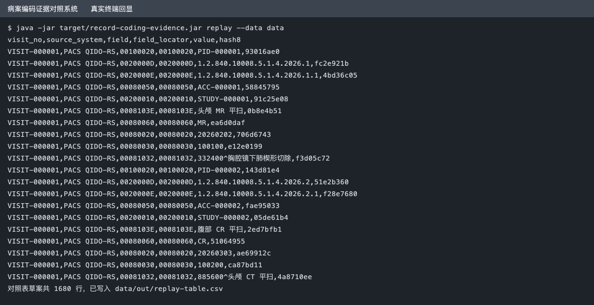
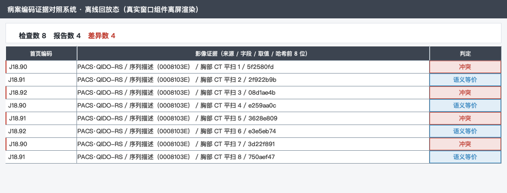
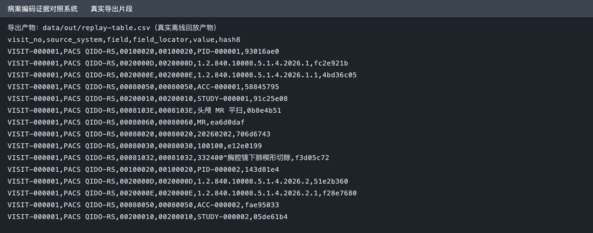

# 病案编码证据对照系统

> 编码员在桌面小工具里填一个住院号 → 程序把这次住院在 PACS 留下的检查元数据和 RIS 推来的报告结论接回来，与病案首页的诊断／手术操作编码摆到同一张对照表上，逐条给出**带证据出处的编码修改建议**；编码员逐条采纳或驳回后提交，病案质控系统里留下一条可复核的编码复核记录。

本工具部署在**病案室编码员工位机**（单机一库），是一个**常驻桌面小工具**（窗口 + 系统托盘），不是跑一次就退出的脚本。它每天固定负责三件事：收 RIS 推来的影像报告并落证据快照、响应编码员的一次住院号复核、等待逐条确认后把复核记录提交进病案质控系统。本机状态（复核批次、证据快照与哈希、每条判定、确认人／时间、幂等键、提交回执、审计链）落在本机 SQLite。

---
## 适用场景 / 目标岗位

| 岗位 | 什么时候用 | 得到什么 |
|------|------------|----------|
| 病案室编码员 | 每日复核待编码病历，一次 5–15 份 | 首页编码与影像证据的逐条对照表、差异归因说明、可直接粘进病案系统的编码修改建议 |
| 病案室质控员 | 编码员提交后复核 | 同一份复核记录上的差异明细、每条建议的证据出处与确认结果 |
| 医保办 DRG 专员 | 每周入组前按批次复核 | 入组前的编码与证据不符清单，定位到具体是哪条编码缺了侧别／部位 |
| 质控科 | 收到复核记录后开整改 | 可导出的差异清单与证据出处，直接作为整改闭环的附件 |

> 本表只写岗位口语与业务时刻。接口路径、字段名、协议细节见「命令 / API / 配置说明」。

---
## 能力要点

- **一次住院号，换回一张能对拍的表** —— 不用登 PACS 网页找检查、导出报告、另开 Excel 抄编码再肉眼比对；程序把检查元数据与报告结论接回来，和首页编码落到同一张对照表上。
- **每一行都带出处** —— 每条证据行都标明来源系统、来源字段和证据哈希，质控科追问「凭什么这么判」时能逐条回溯到原始报文位置。
- **编码先过三层规则校验** —— 结构（位数／字符集／章节归属）、字典映射（编码是否存在）、业务（性别年龄与诊断匹配、诊断与操作匹配）分层给结论；某一层不可用时**明确标注缺哪一层**，不拿模型记忆凑数。
- **语义对拍只出草稿** —— 报告结论里的「右下肺实变影」与首页编码「右下肺感染性病变」能对上，但**采纳与否由编码员逐条点**；未确认前提交按钮是灰态，网关层还会再挡一次。
- **拿不准就说拿不准** —— 住院号命中多个患者标识、字典查不到、模型不可达，这三种情况都显式提示并**拒绝出具判定**，绝不悄悄按「没有差异」放行。
- **留痕可查** —— 每次复核生成不可变审计记录（证据快照哈希、规则版本、确认人／时间、提交回执），导出动作本身也留一条；日志与数据库只落去标识字段。

---
## 快速开始

### 依赖

- **JDK 17 或更高**（LTS；源码以 `--release 17` 编译）
- **Maven 3.8+**（仅构建时需要；院内分发只拷一个 jar）
- 运行期不需要数据库服务、不需要容器：状态落在本机 SQLite 单文件

### 安装

```bash
cd record-coding-evidence
export JAVA_HOME="$(mvn -v | sed -n 's/.*runtime: //p' | sed 's/,.*//')"   # 跟随 Maven 实际使用的 JDK
mvn -q package                                                              # 打出可运行单 jar
ls -lh target/record-coding-evidence.jar
```

### 配置

所有凭据与端点**一律从环境变量读**，代码里不写任何默认端点或密钥；缺关键项时程序**直接退出并列出缺失的变量名**，不回落到本地替身。

```bash
cp .env.example .env && set -a && . ./.env && set +a   # 样例文件不含任何真实凭据
export PACS_BASE_URL="https://<pacs-host>:<port>"   # 缺任一项启动即失败并报出变量名
export PACS_QIDO_TOKEN="<由信息科发放>"
export EMR_BASE_URL="https://<emr-host>:<port>"
export EMR_API_TOKEN="<由信息科发放>"
export QC_BASE_URL="https://<qc-host>:<port>"
export QC_API_TOKEN="<由信息科发放>"
export RIS_MLLP_LISTEN_PORT=2575
export MODEL_BASE_URL="https://<model-host>:<port>"
export MODEL_API_KEY="<由信息科发放>"
export MODEL_NAME="<院内部署的模型名>"
export MODEL_TIMEOUT_SECONDS=30
```

### 构建与验证

```bash
mvn -q test                       # 单元测试（JUnit 5）
mvn -q package                   # 打包
java -jar target/record-coding-evidence.jar --version
bash scripts/verify.sh           # 可重复验证：装依赖 → 跑测试 → 离线回放 → 打印核对结论
```

### 主命令速查

```bash
java -jar target/record-coding-evidence.jar --version                  # 产品名与版本号
java -jar target/record-coding-evidence.jar config-check               # 缺项列出变量名并非零退出
java -jar target/record-coding-evidence.jar conn-check                 # 连接状态 / 待处理 / 已提交
java -jar target/record-coding-evidence.jar case-suite --cases cases   # 14 条案例集回归
java -jar target/record-coding-evidence.jar replay --data data --visit <住院号>   # 离线回放
java -jar target/record-coding-evidence.jar batch --data data          # 批量跑批
java -jar target/record-coding-evidence.jar capture --data data --out docs/screenshots  # 采集实测截图
```

> 运维子命令（`config-check` / `conn-check` / `replay` / `batch`）为**排障与批处理通道**；日常复核走桌面窗口。

---
## 命令 / API / 配置说明

### 关键配置项

| 配置项 | 默认值 | 说明 |
|--------|--------|------|
| `PACS_BASE_URL` | 无（必填） | PACS 根地址，用于拼 QIDO-RS 查询路径 |
| `PACS_QIDO_TOKEN` | 无（必填） | PACS 访问令牌，作为 `Authorization: Bearer` 头发送 |
| `RIS_MLLP_LISTEN_PORT` | `2575` | 本机监听 RIS 报告推送的端口 |
| `EMR_BASE_URL` | 无（必填） | 电子病历根地址 |
| `EMR_API_TOKEN` | 无（必填） | 电子病历访问令牌 |
| `QC_BASE_URL` | 无（必填） | 病案质控系统根地址（回写目标） |
| `QC_API_TOKEN` | 无（必填） | 质控系统访问令牌 |
| `MODEL_BASE_URL` | 无（必填） | 模型服务根地址，OpenAI-compatible 协议 |
| `MODEL_API_KEY` | 无（必填） | 模型服务密钥 |
| `MODEL_NAME` | 无（必填） | 院内部署的模型名 |
| `MODEL_TIMEOUT_SECONDS` | `30` | 单次模型调用超时秒数 |
| `HTTP_TIMEOUT_SECONDS` | `15` | 出站 HTTP 调用超时秒数 |
| `HTTP_RETRY_MAX` | `3` | 5xx 与超时的最大重试次数（4xx 与结构校验失败不重试） |
| `HTTP_RETRY_BACKOFF_MS` | `500` | 退避基数，按次数指数增长 |
| `DB_PATH` | `data/record-coding-evidence.db` | 本机 SQLite 文件位置 |
| `CODER_ID` | 无（必填于提交时） | 编码员工号，作为 `confirmed_by` 写入 |

### CLI 子命令 / 接口端点

| 命令或路径 | 用途 | 关键参数 |
|------------|------|----------|
| `--version` | 打印产品名与版本号 | 无 |
| `config-check` | 校验配置与凭据位，缺项列出变量名 | 无 |
| `conn-check` | 打印连接状态、待处理条数、今日已提交数、降级态 | 无 |
| `replay` | 离线回放本地样例，产出对照表草案 | `--data <目录>`、`--visit <住院号>` |
| `batch` | 批量跑批并输出吞吐与一致率 | `--data <目录>`、`--limit <条数>` |
| `GET {pacs_base_url}/qido/studies` | 取回该患者本次住院的检查元数据（DICOM JSON） | `PatientID`、`includefield`、`limit`；头带 `Authorization: Bearer` 与 `Accept: application/dicom+json` |
| 本机 `{RIS_MLLP_LISTEN_PORT}` | 接收 RIS 推送的 `ORU^R01` 报告 | 分帧 `0x0B … 0x1C 0x0D`；应答 `0x06` ACK / `0x15` NAK |
| `GET {emr_base_url}/api/v1/medical-records/{visit_no}` | 取回病历与病案首页编码 | `visit_no`；头带 `Authorization: Bearer` |
| `POST {qc_base_url}/api/v1/encoding-reviews` | 回写编码复核记录 | 头带 `Authorization: Bearer` 与 `Idempotency-Key: sha256(visit_no\|field\|evidence_hash)` |
| `POST {model_base_url}/chat/completions` | 语义要素抽取与对拍判定 | OpenAI-compatible，请求体带 JSON Schema 约束 |

### 错误与降级

| 场景 | 表现 | 处理方式 |
|------|------|----------|
| 缺端点或令牌 | 启动即退出，stdout 列出缺失的变量名 | 按「对接现有系统」补齐环境变量后重启；不回落到本地替身 |
| PACS / EMR 不可达 | 该来源标为「不可达」，对照表对应区块留缺口标记 | 重试或找信息科；**不当作「没有差异」** |
| 字典明细库不可用 | 字典层标为「字典不可用」，只出结构层与业务层结论 | 配置可插拔字典源或开通官方在线查询；不凭记忆判定编码不存在 |
| 模型不可达 / 超时 / 返回结构不合法 | 切降级态：只出结构校验 + 证据清单 + 全量人工复核 | 窗口顶部与托盘显示降级提示；**提交按钮禁用，不回写任何状态** |
| MLLP 对端连接中断 | 连接状态显式转「不可用」，状态栏与托盘同步提示 | 自动重绑；已收未落库的消息进重试队列 |
| 住院号命中多个患者标识 | 标为「歧义」，**不出具任何判定** | 请信息科核对患者主索引后重试 |
| QC 回写 4xx | 不重试，记可读原因（字段缺失／状态不允许／鉴权失败） | 按原因修正后重新提交 |
| QC 回写 5xx 或超时 | 指数退避重试，**每次重试携带同一幂等键** | 服务端最多留一条复核记录，不会重复 |

### 对接现有系统

| 对端 | 协议与方向 | 取／写的字段 | 凭据来源 |
|------|------------|-------------|----------|
| PACS | QIDO-RS，**读** | `00100020` 患者标识、`0020000D` 检查实例 UID、`0020000E` 序列实例 UID、`00080050` 检查号、`00200010` 检查号/申请号、`0008103E` 序列描述、`00080060` 模态、`00080020`+`00080030` 检查日期时间、`00081032` 手术/操作编码序列 | `PACS_BASE_URL` + `PACS_QIDO_TOKEN` |
| RIS | HL7 v2 `ORU^R01` over MLLP，**收** | `MSH-10` 消息控制号、`PID-3` 患者标识、`PV1-19` 住院号、`OBR-4` 检查标识、`OBX-5` 报告结论、`OBX-14` 报告时间、`OBR-25` 报告状态 | 监听端口 `RIS_MLLP_LISTEN_PORT`；字段位映射外置在 `src/main/resources/hl7-field-mapping.json`，缺映射标「未映射」不猜 |
| 电子病历 / 病案 | REST，**读** | `visit_no`、`patient_id`、`main_diagnosis{code,name}`、`other_diagnosis[]`、`procedure{code,name}`、`gender`、`age`、`admission_time`、`discharge_time` | `EMR_BASE_URL` + `EMR_API_TOKEN` |
| 病案质控系统 | REST，**写** | 请求体含 `visit_no`、`batch_id`、`findings[]{finding_id,home_code,code_system,suggested_codes[],verdict,attribution,evidence_refs[],confirmed_by,confirmed_at}`、`evidence_hash` | `QC_BASE_URL` + `QC_API_TOKEN` + `Idempotency-Key` |
| 模型服务 | OpenAI-compatible，**写** | 结构化输出：`finding_id / home_code / home_code_text / evidence_fact{diagnosis,site,laterality,nature,negation,history} / verdict{equivalent,conflict,report_stale,evidence_missing} / attribution / confidence / evidence_refs` | `MODEL_BASE_URL` + `MODEL_API_KEY` + `MODEL_NAME` |

**干跑与脱敏替身怎么验证**：真实接口不可得时，用 `scripts/fetch-public-data.sh` 拉取的公开样例报文与合成首页编码样例做**离线回放**（`replay` 子命令），以及 `src/test` 下的协议兼容性测试。替身只出现在测试目录与显式的离线回放子命令里，**默认启动路径不指向任何替身**。

---
## 典型场景

### 场景 1：编码员每天早上复核待编码病历

1. 桌面窗口启动后，在左上角输入框填入住院号，点「复核这份病案」。
2. 程序并行取回该次住院的检查元数据与报告结论，装配成对照表；顶部三枚计数器显示检查数、报告数、差异数。
3. 差异行的中栏标明证据来源与哈希前 8 位，右栏给出判定徽章与归因说明；编码员逐条点「采纳建议」或「驳回」（驳回需填理由）。
4. 全部确认后「提交复核记录」才可点，提交进入病案质控系统并留一条审计记录。

```bash
# 排障时用同一批样例走等价路径（离线回放）
java -jar target/record-coding-evidence.jar replay --data data --visit <住院号>
```

### 场景 2：医保办 DRG 专员入组前按批次复核

1. 周一上午拿到本周待入组批次，导出住院号清单。
2. 用 `batch` 子命令跑批：逐条装配证据并产出差异计数，不产生任何写回动作；日志给出条数、耗时、吞吐与归一一致率，一致率低于阈值时判跑批失败并列出偏差样例。

```bash
java -jar target/record-coding-evidence.jar batch --data data --limit 200
# 结果摘要落在 logs/ 下：条数 / 耗时 / 吞吐 / 一致率
```

### 场景 3：质控科拿到复核记录开整改

1. 编码员提交后，质控科在病案质控系统里看到这次复核的差异清单与每条建议的处理结果。
2. 导出复核记录（CSV / JSON），连同审计链一起作为整改闭环附件。
3. 导出动作本身也生成一条审计事件，可在审计链里查到导出人、时间与导出范围。

导出复核记录在桌面窗口点「导出复核记录」（CSV / JSON 二选一），导出动作本身写入审计链；一致性自检走只读的运维子命令，不产生任何写回：

```bash
# 连通状态 / 待处理条数 / 今日已提交数 / 降级态 / 最近错误 / 错误码表条目数
java -jar target/record-coding-evidence.jar conn-check
# 案例集回归：逐条核对四值判定、报告陈旧、证据缺失与缺口语义
java -jar target/record-coding-evidence.jar case-suite --cases cases
```

---
## 输出样例

### 对照表草案与复核记录导出（终端回显 / CSV / JSON）

`replay` 子命令把两路来源归一为同一张表：120 份 DICOM JSON 各取 10 个证据 tag、60 条 HL7 报文各取 8 个角色，共 1680 行写入 `data/out/replay-table.csv`。序列型 tag 按 DICOM 编码串口径投影为「编码^含义」，不把嵌套 JSON 塞进取值列。

```csv
visit_no,source_system,field,field_locator,value,hash8
VISIT-000001,PACS·QIDO-RS,00100020,00100020,PID-000001,93016ae0
VISIT-000001,PACS·QIDO-RS,0020000D,0020000D,1.2.840.10008.5.1.4.2026.1,fc2e921b
VISIT-000001,PACS·QIDO-RS,00081032,00081032,332400^胸腔镜下肺楔形切除,f3d05c72
VISIT-000001,RIS·HL7-MLLP,report_conclusion,OBX-5,术前已诊断右下肺炎，术后复查吸收,32a396fb
```

复核记录导出 CSV / JSON 全文、可粘贴的编码修改建议文本，以及更长的输出样例见 [`docs/examples.md`](docs/examples.md)；三张实测截图在下节「实测证据」逐张列出。

### 证据抽屉与建议详情（界面渲染）

主窗口由三栏对照表 + 顶部计数器 + 证据抽屉 + 建议详情面板组成：左栏首页编码，中栏是来源系统 / 字段定位 / 取值 / 哈希前 8 位，右栏是判定徽章；冲突行左侧 2px 红色竖条，未确认判定走琥珀色「待确认」徽章。加载中 / 空数据 / 错误三态由 `UiState` 集中定义，三类空态文案互不相同，错误态带错误码与处理建议。

---
## 概念 / 实测对照

### 视觉目标

结构化视觉目标卡见 [`docs/concepts/visual-target.md`](docs/concepts/visual-target.md)，含起始态、首个可用瞬间、成形态三个状态的构图、配色值（`#F5F6F8` 底 / `#FFFFFF` 卡片 / `#3C4450` 表头 / `#1A6FD4` 强调蓝 / `#C0392B` 冲突红 / `#D68910` 待确认琥珀）、中文字体族与信息层级。目标卡**只做文字结构化描述，不放概念图**；真实运行截图单独放在 [`docs/screenshots/`](docs/screenshots/)，两者不混放。

### 实测证据

`capture` 子命令一次采集三张截图，全部来自当日真实运行实例，不是设计稿或示意图：终端取自 `replay` 的真实 stdout，界面由真实 `ComparisonPanel` / `CountersPanel` / `JTable` 组件离屏绘制，导出片段回读本次 `data/out/replay-table.csv` 前 16 行。







同一轮验证记录：`mvn test` 共 97 个用例（13 个测试类），0 失败 0 错误；`scripts/verify.sh` 依次跑数据生成、全量测试、单 jar 打包与离线回放；`data/manifest.json` 记录 120 份 DICOM JSON / 240 条 EMR / 60 条 HL7 与逐文件、总体 sha256（`433372b821fc5076c526e8b08b5815371b285c5bcd6863cc7e1c78e2cba95c29`），脚本重跑结果一致。

> **诚实标注**：上一节「视觉目标」是**设计意图**（结构化文字目标卡，不含图片），本节三张是**真实实测**。目标与实现在视觉上必然有差距：目标卡描述的是理想的信息密度与徽章质感，实测截图反映的是当前实现的真实渲染结果；两者**不声称完全一致**。任何情况下都不使用概念图或设计稿冒充实测截图。

---
## 架构与数据流

```
┌──────────────┐   QIDO-RS (DICOM JSON)   ┌───────────────────────────────┐
│     PACS     │ ─────────────────────────▶│  ① 接进来 / 取回              │
│  检查元数据  │                            │  transport/ · protocol/      │
└──────────────┘                            │  只取证据所需字段，不取影像本体 │
                                            └───────────────┬───────────────┘
┌──────────────┐   HL7 v2 ORU^R01 (MLLP)                    │
│     RIS      │ ─────────────────────────▶┌───────────────┴───────────────┐
│  影像报告    │                            │  ② 类型化解析                 │
└──────────────┘                            │  时区与精度显式 · 缺字段标缺失  │
                                            └───────────────┬───────────────┘
┌──────────────┐   REST (读)               ┌───────────────┴───────────────┐
│  电子病历    │ ─────────────────────────▶│  ③ 装配成交付物                │
│  病案首页    │                            │  跨源证据归一 → 三层校验       │
└──────────────┘                            │  → 语义对拍与归因              │
                                            └───────────────┬───────────────┘
┌──────────────┐   REST (写)                            ▼
│  病案质控    │ ◀─────────────────────┌───────────────────────────────┐
│  系统        │   Idempotency-Key     │  ④ 逐条确认 → 提交             │
└──────────────┘                       │  confirmed_by / confirmed_at   │
                                       └───────────────┬───────────────┘
┌──────────────┐   OpenAI-compatible                   ▼
│  模型服务    │ ◀─────────────────────┌───────────────────────────────┐
└──────────────┘   结构化输出          │  ⑤ 留审计（本机 SQLite）       │
                                       │  批次/证据/判定/确认/幂等/回执 │
                                       └───────────────────────────────┘
```

### 关键不变量

- **幂等键**：QC 回写携带 `Idempotency-Key = sha256(visit_no|field|evidence_hash)`；同一幂等键重复提交，服务端只留一条复核记录，重试也携带同一把键。
- **并发与重放防护**：MLLP 消息按 `MSH-10` 消息控制号去重，重投不重复入证据快照；证据快照与哈希、判定与确认、幂等键与回执各自在同一事务内写入，中途失败整体回滚，不留半条记录。
- **状态校验**：批次状态迁移表显式枚举（待复核 → 证据已取回 → 已判定 → 待确认 → 已确认 → 已提交）；非法迁移抛错并记错误码，**模型任何路径都不能把状态推到「已确认」**。
- **失败不静默改数据**：来源不可达标「不可达」、字典不可用标「字典不可用」、模型不可达切降级态并禁用提交；任何一种都不改写既有编码、不推进状态、不产生写回请求。
- **歧义即拒**：住院号 ↔ 患者标识 ↔ 检查实例 UID 三方绑定多命中或零命中时，**不出具判定**，绝不「取第一条」。
- **证据可回溯**：对照表每一行都带证据出处（来源系统 + 来源字段 + 证据哈希），悬空引用视为装配失败并记错误码。

---
## 安全与合规边界

- 本工具只做**编码与文书层面**的结构整理、缺项／矛盾／时间序提示与建议草稿，**不输出诊断或治疗建议**，不生成可直接下发的医嘱。
- 模型输出**一律为草稿**：编码结论由编码员逐条「采纳 / 驳回」后确认并承担责任；程序不代签、不自动签名，也不会在未确认时推进任何业务状态。
- 日志与本机 SQLite **只落去标识字段**，不落姓名、身份证、联系方式等患者可识别明细；住院号作为业务主键保留。
- 本工具不新建账号体系、不提供对外服务面，院内身份与权限仍走既有 HIS / EMR。

---
## 验收与自检

| 验收项 | 命令 | 期望结果 |
|--------|------|----------|
| 版本自检 | `java -jar target/record-coding-evidence.jar --version` | 打印产品名与版本号，退出码 0 |
| 缺配置即失败 | 缺 `PACS_BASE_URL` 时运行 `config-check` | 非零退出，stdout 列出缺失变量名 |
| 单元测试 | `mvn -q test` | 全部通过 |
| 离线回放产出第一份产物 | `java -jar target/record-coding-evidence.jar replay --data data --visit <住院号>` | stdout 打印对照表草案行，`data/out/replay-table.csv` 同步生成 |
| 可重复验证 | `bash scripts/verify.sh` | 装依赖 → 跑测试 → 离线回放 → 打印核对结论 |
| README 丰度自检 | `grep -c '^## ' README.md` 等 | 章节数、表格数、代码块数与实测截图引用均达标 |

---
## 项目结构

```
record-coding-evidence/
├── README.md                          # 本文件：中文产品说明（用户向）
├── LICENSE                            # MIT 许可
├── qrcode.jpg                         # 公众号二维码（关注区块引用）
├── pom.xml                            # Maven 构建：Java 17、SQLite 驱动、JUnit 5、shade 打单 jar
├── .env.example                       # 配置项样例（无任何真实凭据）
├── .gitignore                         # 排除 .env / data/ / logs/ / target/ / 各类缓存
├── docs/
│   ├── concepts/visual-target.md      # 结构化视觉目标卡（起始态 / 首个可用瞬间 / 成形态）
│   ├── screenshots/                   # 真实运行截图（终端回显 / 界面渲染 / 导出片段）
│   ├── cli.md                         # 运维 CLI 子命令速查（从 README 外移）
│   └── examples.md                    # 输出样例全文（从 README 外移）
├── scripts/
│   ├── fetch-public-data.sh           # 公开样例下载 + 合成 + 完整性校验（可重跑、断网降级）
│   └── verify.sh                      # 可重复验证：装依赖 → 跑测试 → 离线回放 → 打印结论
├── cases/                             # 案例集（case_id / input / expect / basis / confidence）
├── data/                              # 运行时数据与本地样例（被 .gitignore 排除）
├── logs/                              # 运行日志与跑批结果（被 .gitignore 排除）
└── src/
    ├── main/java/com/chaosforge/recordcoding/
    │   ├── app/                       # 入口：App（桌面程序）/ AppCli（运维子命令）/ ReplayCommand（离线回放）
    │   ├── config/                    # AppConfig（环境变量凭据位）/ FieldMapping（外置映射）/ ConfigException
    │   ├── domain/                    # 病案域模型与住院实体绑定（多命中即拒）
    │   ├── transport/                 # HTTP 底座（超时/重试/五类错误码）与 QIDO / EMR / QC / MLLP 客户端
    │   ├── protocol/                  # 协议模型：hl7 严格分词 / dicom 属性选择器 / time 临床时刻
    │   ├── evidence/                  # 跨源证据归一与稳定哈希（核心模块）
    │   ├── coding/                    # 编码三层校验：结构 / 字典映射 / 业务
    │   ├── semantic/                  # 要素抽取 / 四值判定 / 差异归因（模型承担）
    │   ├── modelgw/                   # 单一模型出口：OpenAI-compatible 网关与结构化 Schema
    │   ├── store/                     # 本机 SQLite：批次 / 证据 / 判定 / 确认 / 幂等 / 回执 / 审计
    │   ├── service/                   # 主路径编排：取回 → 装配 → 判定 → 确认 → 提交
    │   ├── ui/                        # 桌面界面：三栏对照表 / 计数器 / 证据抽屉 / 详情面板 / 托盘
    │   ├── ui/theme/                  # 设计 token：色板 / 间距刻度 / 字体层级
    │   └── export/                    # 复核记录导出与可粘贴建议文本
    ├── main/resources/                # hl7-field-mapping.json（外置字段语义映射）等配置
    └── test/java/com/chaosforge/recordcoding/   # golden / 兼容性 / 幂等 / 降级阻断测试
```

---
## License

MIT

---
## 关注我们

欢迎扫码关注公众号，获取项目更新与交流加群：


---

## 关注我们

欢迎扫码关注公众号，获取项目更新与交流加群：

